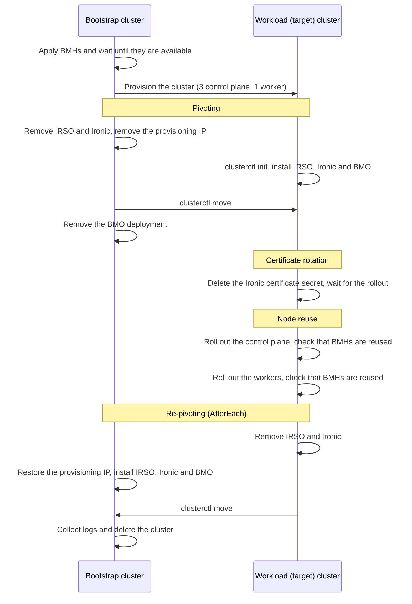

# Pivoting based e2e tests

This document describes the sequence of events in the pivoting based e2e
tests: pivoting, certificate rotation, node reuse and re-pivoting. All four
run in a single Ginkgo spec, `Testing features in target cluster`, defined in
`test/e2e/pivoting_based_feature_test.go`.

## Overview

The spec creates a workload cluster from the bootstrap (kind) cluster, makes
that workload cluster self-hosted and then exercises CAPM3 features while the
management components run inside it. The tests depend on each other and always
run in this order:

1. Pivoting: move the management components and the cluster resources from
   the bootstrap cluster to the workload cluster (`test/e2e/pivoting.go`).
1. Certificate rotation: rotate the Ironic TLS certificate in the self-hosted
   cluster (`test/e2e/cert_rotation.go`).
1. Node reuse: roll out the control plane and the workers with node reuse
   enabled and check that the same BareMetalHosts (BMHs) are reused
   (`test/e2e/node_reuse.go`).
1. Re-pivoting: move everything back to the bootstrap cluster
   (`test/e2e/pivoting.go`).

Re-pivoting runs in the `AfterEach` block, so it also runs when one of the
earlier tests fails, as long as the workload cluster was created.

The spec carries the `pivoting` and `features` labels. Run it with:

```bash
GINKGO_FOCUS=pivoting ./scripts/ci-e2e.sh
```

For this focus `scripts/environment.sh` sets `NUM_NODES` to 4 and, unless
they are already set, `CONTROL_PLANE_MACHINE_COUNT` to 3 and
`WORKER_MACHINE_COUNT` to 1.



## Workload cluster creation

1. Create one BMH per node in the `metal3` namespace of the bootstrap cluster
   and wait until all of them are `available`.
1. Apply the cluster template with Kubernetes version
   `KUBERNETES_VERSION_UPGRADE_FROM`, then wait for the cluster, the control
   plane and the MachineDeployment to come up and for all pods in
   `kube-system` of the workload cluster to be running.

## Pivoting

Pivoting turns the workload cluster into a self-hosted management cluster.

1. Collect the logs of the workload cluster and the manifests of the
   bootstrap cluster, and copy the workload cluster kubeconfig to
   `/tmp/kubeconfig-test1.yaml` for log collection in CI.
1. Uninstall Ironic and the Ironic Standalone Operator (IRSO) from the
   bootstrap cluster.
1. Remove the Ironic provisioning IP from the bootstrap kind node. Otherwise
   the kind node keeps answering ARP requests for that IP while nothing
   listens on it, and Ironic in the workload cluster becomes unreachable at
   times.
1. Run `clusterctl init` against the workload cluster to install the CAPI
   core, the kubeadm bootstrap and control plane providers, CAPM3 and the
   Metal3 IPAM provider. The CAPI version comes from `CAPIRELEASE`, or the
   latest stable release of the minor version in `CAPI_RELEASE_PREFIX` when
   `CAPIRELEASE` is not set.
1. Label the `baremetalhosts.metal3.io` and `hardwaredata.metal3.io` CRDs in
   the bootstrap cluster so that `clusterctl move` also moves the BMHs and
   their HardwareData.
1. Install IRSO and Ironic, and then the Bare Metal Operator (BMO), in the
   workload cluster.
1. Check that the API servers of both clusters answer requests consistently
   for a few seconds, which avoids flaky failures during the move.
1. Run `clusterctl move` from the bootstrap cluster to the workload cluster.
1. Delete the BMO deployment from the bootstrap cluster.
1. In the workload cluster, wait for the Cluster and the KubeadmControlPlane,
   and then for all BMHs to be `provisioned`, all Metal3Machines to be ready
   and all Machines to be `Running`.

## Certificate rotation

Certificate rotation checks that Ironic picks up a new TLS certificate when
cert-manager regenerates it. It runs in the self-hosted workload cluster.

1. Wait until the `ironic` Ironic resource is ready and record the
   `tls-secret-version` annotation and the revision of the `ironic-service`
   deployment.
1. Delete the `ironic-cert` secret and check that it is gone.
1. Wait until cert-manager creates the secret again and Ironic is ready.
1. Check that the `tls-secret-version` annotation has changed and that the
   deployment revision has increased by exactly one, which means that the
   Ironic pods were rolled out with the new certificate.

## Node reuse

Node reuse checks that, when `nodeReuse` is enabled on a Metal3MachineTemplate,
a rolling update provisions the new Machines on the BMHs that the old Machines
released. The test runs in the self-hosted workload cluster, so CAPM3 in that
cluster rolls out the Machines of its own cluster. The upgrade target is
`KUBERNETES_VERSION_PATCH_TO`; the version itself is not important as long as
the change triggers a rollout (see
[Environment Variables](e2e-test.md#environment-variables)).

### KubeadmControlPlane

1. Remove the `NoSchedule` taints from the control plane nodes, so that the
   workloads can run on them once there are no workers.
1. Scale the MachineDeployment to 0 and wait until the released BMH is
   `available`, then wait for all pods in `kube-system` to be running.
1. Record the names of all provisioned BMHs.
1. Download the node image for `KUBERNETES_VERSION_PATCH_TO`.
1. Set `nodeReuse: true` on the `test1-controlplane` Metal3MachineTemplate and
   create `test1-new-controlplane` from it with the new image.
1. Patch the KubeadmControlPlane to use the new template and Kubernetes
   version, with `maxSurge: 0` so that each old Machine is deleted before its
   replacement is created. The patch also clears the node registration taints,
   so the new control plane nodes are not tainted either.
1. Wait until one Machine is `Deleting` and check that no Machine is
   `Provisioning` yet.
1. Wait until one BMH is `deprovisioning`, then until the same BMH is
   `available` again and finally `provisioning` again, which shows that the
   released BMH is reused for the replacement Machine.
1. Wait until all control plane Machines are `Running` with the new version.
1. Check that the Metal3Machine that consumes the reused BMH has the
   `AssociateBareMetalHost` condition with the
   `AssociateBareMetalHostViaNodeReuseSuccess` reason.
1. Wait for all pods in `kube-system` to be running and check that the set of
   provisioned BMHs is the same as before the rollout.

### MachineDeployment

1. Set `maxSurge` of the KubeadmControlPlane back to 1 and scale the control
   plane down to 1 Machine, which frees BMHs for the worker test. Wait until
   the released BMHs are `available`, only one control plane node is left and
   all pods in `kube-system` are running.
1. Scale the MachineDeployment up to 1 and wait until the worker Machine is
   `Running` with `KUBERNETES_VERSION_UPGRADE_FROM`.
1. Record the names of all provisioned BMHs.
1. Remove the node reuse label (`infrastructure.cluster.x-k8s.io/node-reuse`)
   from all `available` BMHs. The control plane rollout left it on the BMHs
   that were released by the scale down, and the label would keep CAPM3 from
   choosing them for the workers.
1. Set `nodeReuse: true` on the `test1-workers` Metal3MachineTemplate and
   create `test1-new-workers` from it with the new image.
1. Patch the MachineDeployment to use the new template and Kubernetes version,
   with `maxSurge: 0` and `maxUnavailable: 1`.
1. Wait until one BMH is `deprovisioning`, then until the same BMH is
   `available` and `provisioning` again.
1. Wait until the worker Machine is `Running` with the new version and check
   the `AssociateBareMetalHost` condition of its Metal3Machine as above.
1. Check that the set of provisioned BMHs is the same as before the rollout.
1. Scale the control plane back up to 3 Machines, then wait until all BMHs are
   `provisioned`, all Machines are `Running` and all pods in `kube-system` are
   running.

## Re-pivoting

Re-pivoting moves the management components and the cluster resources back
to the bootstrap cluster, so that the cluster can be deleted from there.
Before it starts, the `AfterEach` block lists the BMHs, Metal3Machines,
Machines and Nodes of both clusters and dumps the resources of the workload
cluster.

1. Collect the logs and manifests of both clusters.
1. Label the BMH and HardwareData CRDs in the workload cluster for
   `clusterctl move`.
1. Uninstall Ironic and IRSO from the workload cluster.
1. Add the Ironic provisioning IP back to the bootstrap kind node.
1. Install IRSO and Ironic, and then BMO, in the bootstrap cluster.
1. Check that the bootstrap API server answers requests consistently.
1. Run `clusterctl move` from the workload cluster to the bootstrap cluster.
1. In the bootstrap cluster, wait for the Cluster and the
   KubeadmControlPlane, and then for all BMHs to be `provisioned`, all
   Metal3Machines to be ready and all Machines to be `Running`.

## Cleanup

After re-pivoting, the `AfterEach` block collects the logs and manifests of
both clusters and the logs of the vbmctl lab containers, and dumps the Cluster
API resources of the `metal3` namespace. Unless cleanup is skipped, it then
deletes the cluster from the bootstrap cluster and waits until all Metal3Data
and Metal3DataClaim objects are gone.
