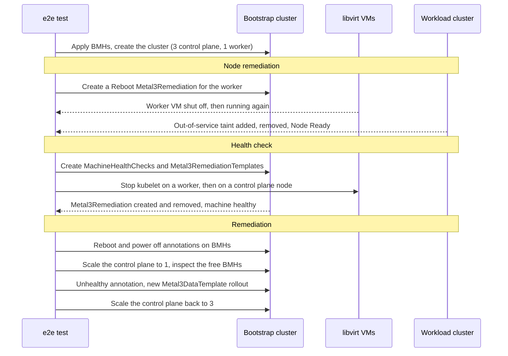

# Remediation based e2e tests

This document describes the sequence of events in the remediation based e2e
tests: Metal3Remediation, MachineHealthCheck based remediation, the BMH
annotation tests and inspection. All of them run in a single Ginkgo spec,
`Testing nodes remediation`, defined in
`test/e2e/remediation_based_feature_test.go`.

## Overview

Unlike the [pivoting based tests](e2e-test.md#pivoting-based-feature-tests),
these tests do not pivot. The management components stay in the bootstrap
(kind) cluster, and the tests act on the BareMetalHosts (BMHs), Machines and
Metal3Machines there and on the Nodes of the workload cluster. The power state
of the hosts is read directly from libvirt (`virsh list`).

The tests run in this order:

1. Node remediation: remediate a worker with a manually created
   Metal3Remediation (`test/e2e/node_deletion_remediation.go`). It runs first
   because, as noted in the spec, it does not work after the remediation
   test.
1. Health check: let MachineHealthChecks remediate an unhealthy worker and an
   unhealthy control plane machine (`test/e2e/healthcheck.go`).
1. Remediation: power cycle hosts with BMH annotations, run the inspection
   test, check the unhealthy annotation and roll out the workers with a new
   Metal3DataTemplate (`test/e2e/remediation.go` and
   `test/e2e/inspection.go`).

The spec carries the `remediation` and `features` labels. Run it with:

```bash
GINKGO_FOCUS=remediation ./scripts/ci-e2e.sh
```

For this focus `scripts/environment.sh` sets `NUM_NODES` to 4 and, unless
they are already set, `CONTROL_PLANE_MACHINE_COUNT` to 3 and
`WORKER_MACHINE_COUNT` to 1. The tests below assume these numbers.



## Workload cluster creation

1. Create one BMH per node in the `metal3` namespace of the bootstrap cluster
   and wait until all of them are `available`.
1. Apply the cluster template with Kubernetes version
   `KUBERNETES_VERSION_UPGRADE_FROM`, then wait for the cluster, the control
   plane and the MachineDeployment to come up and for all pods in
   `kube-system` of the workload cluster to be running.

## Node remediation

Node remediation checks the `Reboot` strategy of the CAPM3 remediation
controller, including how it handles the Node of the remediated machine.

1. Pick the first worker Metal3Machine, its BMH and its Machine.
1. Create a Metal3Remediation with the name of the Machine, owned by the
   Machine, with the `Reboot` strategy, a retry limit of 1 and a timeout of 30
   minutes.
1. Wait until the VM of the BMH is shut off.
1. If `KUBERNETES_VERSION` is 1.28 or newer, wait until the
   `node.kubernetes.io/out-of-service=nodeshutdown:NoExecute` taint is added
   to the Node and then removed again. For older versions, wait until the
   Node is deleted instead.
1. Wait until the VM is running again and the Node is `Ready`.
1. Delete the Metal3Remediation and wait until it is gone, which shows that
   the controller removed its finalizer.

## Health check

The health check test lets Cluster API detect unhealthy machines and
remediate them through a Metal3RemediationTemplate.

1. Create a Metal3RemediationTemplate with the `Reboot` strategy, a retry
   limit of 1 and a timeout of 300 seconds, and a MachineHealthCheck that uses
   it for the workers (selected by the `nodepool: nodepool-0` label). The
   MachineHealthCheck treats a Node as unhealthy when its `Ready` condition is
   `Unknown` or `False` for 300 seconds.
1. Find the IP address of the worker in the baremetal IPv4 IPPool of the
   cluster and stop kubelet on it over SSH.
1. Wait until the MachineHealthCheck reports 0 healthy machines and a
   Metal3Remediation with the name of the worker Machine exists.
1. Wait until the MachineHealthCheck reports 1 healthy machine again and the
   Metal3Remediation is gone.
1. Repeat the steps above for the control plane, with a second
   Metal3RemediationTemplate and MachineHealthCheck that select the machines
   with the `cluster.x-k8s.io/control-plane` label. The healthy count goes
   from 3 to 2 and back to 3.
1. Delete both Metal3RemediationTemplates and wait until they are gone.

## Remediation

The remediation test checks the BMH annotations that CAPM3 and the Bare Metal
Operator (BMO) handle, and runs the inspection test in the middle.

### Reboot and power off annotations

1. Add the `reboot.metal3.io` annotation to the BMH of the worker. Wait until
   the VM is shut off, then running, and the Node is `Ready` again.
1. Power cycle the worker: add the `reboot.metal3.io/poweroff` annotation to
   its BMH, wait until the VM is shut off, remove the annotation, wait until
   the VM is running and the Node is `Ready`, and then check that the Node
   stays `Ready` for a while.
1. Power cycle 1 control plane machine in the same way.
1. Power cycle the 2 other control plane machines at the same time.

### Inspection

1. Scale the KubeadmControlPlane down to 1 replica and wait until 2 BMHs are
   `available`.
1. Add the `inspect.metal3.io` annotation to all `available` BMHs, wait until
   they are `inspecting` and then `available` again.

### Unhealthy annotation

1. Add the `capm3.metal3.io/unhealthy` annotation to the BMH of the worker and
   delete the worker Machine.
1. Wait until that BMH is deprovisioned and `available`, and until the
   MachineDeployment has replaced the worker, so that 2 BMHs are
   `provisioned`.
1. Scale the MachineDeployment up to 3 replicas. Wait until 3 BMHs are
   `provisioned`, then check that for a while no BMH starts `provisioning`:
   the only `available` BMH is the unhealthy one, so CAPM3 must not pick it
   for the remaining worker.
1. Remove the unhealthy annotation and wait until all 4 BMHs are
   `provisioned` and all 4 Machines are `Running`.

### Metal3DataTemplate rollout

1. Scale the MachineDeployment down to 1 replica and wait until 2 BMHs are
   `available`.
1. Create the `test-new-m3dt` Metal3DataTemplate as a copy of
   `test1-workers-template`, and the `test-new-m3mt` Metal3MachineTemplate as a
   copy of `test1-workers` that uses the new Metal3DataTemplate.
1. Point the MachineDeployment to `test-new-m3mt` with `maxUnavailable: 1`,
   which rolls out the worker. Wait until 2 BMHs are `available` and
   Metal3Data objects exist in the namespace.
1. Scale the KubeadmControlPlane back up to 3 replicas and wait until all 4
   BMHs are `provisioned` and all 4 Machines are `Running`.

## Cleanup

The `AfterEach` block lists the BMHs, Metal3Machines, Machines and Nodes,
collects the logs and manifests of both clusters and the logs of the vbmctl
lab containers, and dumps the Cluster API resources of the `metal3`
namespace. Unless cleanup is skipped, it then deletes the cluster and waits
until all Metal3Data and Metal3DataClaim objects are gone.
